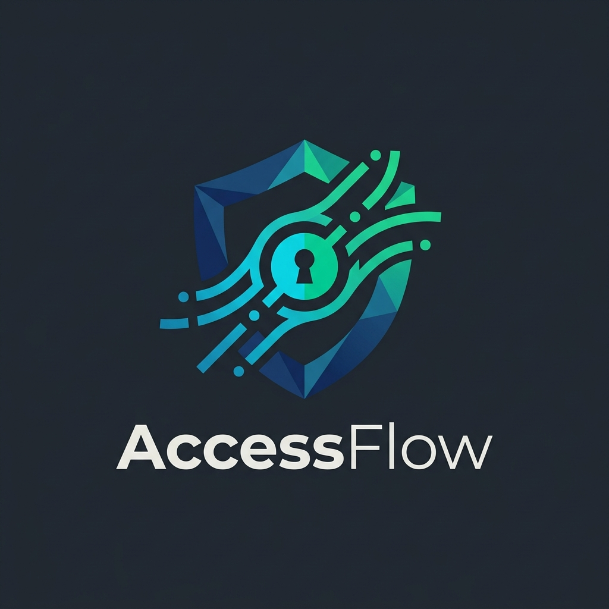

<div align="center">



# AccessFlow — Employee Access Management

**Корпоративная банковская система автоматизации подачи, согласования и исполнения заявок на доступ к информационным системам**

[](https://github.com/mensferrea/AccessFlow/actions)
[](https://www.python.org/)
[](https://fastapi.tiangolo.com/)
[](https://www.postgresql.org/)
[](https://www.docker.com/)
[](https://camunda.com/)
[](https://spec.openapis.org/oas/v3.1.0)
[](LICENSE)

</div>

---

## 📌 О проекте

**AccessFlow** — комплексный проект системного анализа и действующий микросервисный прототип для централизованного управления жизненным циклом прав сотрудников банка. Система решает проблему длительного предоставления доступов (SLA сокращается с 5-7 дней до ≤ 4 часов), исключает риск выдачи избыточных привилегий и обеспечивает 100% аудируемость операций согласно требованиям регуляторов (СТО БР ИББС, ГОСТ Р 57580.1-2017).

Ключевой фокус проекта — **профессиональный системный анализ**:
- 🔄 Моделирование сквозных бизнес-процессов **AS-IS → TO-BE** в нотации **BPMN 2.0** (Camunda Modeler);
- 📋 Формализация требований: Бизнес-требования (**BRD**), Функциональные требования (**FRS**), Бизнес-правила и матрица состояний (**State Machine**);
- 🧩 Архитектурное моделирование: Контекстная диаграмма C4, диаграмма последовательности (UML Sequence), ER-диаграмма в нотации **PlantUML**;
- 🔗 Интеграционные спецификации: **REST OpenAPI 3.1**, XML/XSD схема для legacy АБС, коллекция **Postman**;
- 🧪 Обеспечение качества: Матрица трассировки требований (**RTM**) в Excel (.xlsx) и Markdown, 100% проходящие автотесты (**Pytest**).

---

## 🏗 Архитектура и структура репозитория

Проект спроектирован в строгом соответствии с принципами чистой архитектуры:

```
AccessFlow/
├── .github/
│   └── workflows/ci.yml       # GitHub Actions CI (PostgreSQL 16 + Pytest)
├── docs/
│   ├── bpmn/
│   │   ├── as_is_access_process.bpmn  # BPMN 2.0 модель текущего процесса (AS-IS)
│   │   └── to_be_access_process.bpmn  # BPMN 2.0 модель целевого процесса (TO-BE)
│   ├── business_requirements/
│   │   └── BRD.md             # Документ бизнес-требований (SMART-цели, границы, BR-01..09)
│   ├── functional_requirements/
│   │   ├── FRS.md             # Спецификация функциональных и нефункциональных требований
│   │   └── state_machine.md   # Машина состояний и матрица допустимых переходов
│   ├── diagrams/
│   │   ├── context_diagram.puml # C4 Context диаграмма взаимодействия систем
│   │   ├── sequence_diagram.puml # UML Sequence сквозного провижининга
│   │   ├── er_diagram.puml    # UML ER диаграмма модели базы данных
│   │   └── state_diagram.puml # UML State Machine жизненного цикла заявки
│   ├── images/
│   │   └── logo.png           # Фирменный логотип системы
│   ├── integration/
│   │   ├── contracts/legacy_access_message.xsd # Строгая XSD-схема legacy XML-обмена
│   │   ├── examples/          # Эталонные XML-сообщения запроса и ответа
│   │   ├── openapi/accessflow_api.yaml # Спецификация REST API OpenAPI 3.1
│   │   └── postman/accessflow_postman_collection.json # Коллекция Postman
│   ├── testing/
│   │   ├── Traceability_Matrix_and_Test_Cases.xlsx # Полноценная матрица трассировки (RTM) в Excel
│   │   └── traceability_matrix_and_test_cases.md # Матрица трассировки в Markdown для Git
│   └── user_guide/
│       └── user_manual.md     # Пошаговая инструкция для всех ролей
├── app/
│   ├── api/routes.py          # REST API эндпоинты (FastAPI)
│   ├── services/
│   │   ├── audit_service.py   # Неизменяемый журнал аудита (Audit Trail)
│   │   ├── external_clients.py # Интеграционные клиенты HRIS и IAM (Idempotency-Key)
│   │   ├── request_service.py # Сервис бизнес-логики и маршрутизации заявок
│   │   └── xml_validator.py   # Валидатор XML сообщений по XSD-контрактам
│   ├── config.py              # Pydantic Settings конфигурация
│   ├── database.py            # Асинхронное подключение SQLAlchemy + Asyncpg
│   ├── main.py                # Конфигурация FastAPI, lifespan и предзаполнение БД
│   ├── models.py              # Реляционные сущности БД
│   └── schemas.py             # DTO и схемы валидации Pydantic v2
├── tests/
│   ├── conftest.py            # Настройка тестового окружения и очистки БД
│   ├── test_integration.py     # Тесты обработки сбоев IAM, повторов (Retry) и коллизий
│   ├── test_requests.py       # Тесты жизненного цикла заявок и согласований
│   └── test_xml_validator.py  # Тесты валидации XML/XSD
├── docker-compose.yml         # Сборка сервисов (PostgreSQL 16 + App)
├── Dockerfile                 # Multi-stage Docker образ
├── main.py                    # Корневая точка входа для запуска
├── pytest.ini                 # Конфигурация запуска тестов
├── requirements.txt           # Зависимости проекта
├── LICENSE                    # Лицензия MIT
└── README.md                  # Руководство проекта
```

---

## 💡 Основные архитектурные решения

### 1. Интеллектуальная маршрутизация согласований
- **Стандартный доступ (`is_privileged = false`)**: Для минимизации бюрократии заявка требует подтверждения только прямого руководителя, после чего сразу отправляется на автоматический провижининг в IAM.
- **Привилегированный доступ (`is_privileged = true`)**: Согласно принципу разделения обязанностей (SoD), формируется обязательный консилиум из 3 этапов:
  $$\text{Сотрудник} \longrightarrow \text{Руководитель} \longrightarrow \text{Владелец ИС} \longrightarrow \text{Служба ИБ} \longrightarrow \text{IAM}$$

### 2. Интеграция с внешними системами
- **HRIS (Кадровая система)**: Синхронная проверка активности сотрудника в момент создания заявки. Уволенные (`DISMISSED`) или заблокированные сотрудники не могут создавать заявки (HTTP 403 Forbidden).
- **IAM (Система управления доступом)**: Провижининг вызывается с заголовком `Idempotency-Key` (UUID заявки), что исключает дублирование прав при повторных вызовах.
- **Отказоустойчивость и Retry Policy**: При сбое сервиса IAM система предпринимает до 3 повторных попыток. В случае постоянного сбоя заявка переводится в статус `FAILED`, и администратору доступен ручной перезапуск через эндпоинт `POST /api/v1/requests/{id}/retry`.
- **Legacy XML/XSD**: Разработан строгий контракт `legacy_access_message.xsd`. Сервис валидирует XML-сообщения на уровне схемы до передачи во внешний контур.

### 3. Неизменяемый журнал аудита (Audit Trail)
Любое действие (подача, согласование, отказ с обязательной причиной, ошибка IAM, ручной повтор) атомарно логируется в таблицу `audit_logs` с фиксацией актора, временной метки и контекста изменений (старый/новый статус, параметры).

---

## 🚀 Быстрый старт

### Вариант 1: Запуск в Docker (Рекомендуемый)

```bash
# Клонируйте репозиторий
git clone https://github.com/mensferrea/AccessFlow.git
cd AccessFlow

# Запустите сервисы (PostgreSQL 16 + FastAPI)
docker compose up -d
```

- **Swagger UI (Интерактивная документация)**: [http://localhost:8000/docs](http://localhost:8000/docs)
- **OpenAPI Schema (JSON)**: [http://localhost:8000/openapi.json](http://localhost:8000/openapi.json)

---

### Вариант 2: Локальный запуск

```bash
# Создайте и активируйте виртуальное окружение
python -m venv .venv
source .venv/bin/activate  # Для Linux/macOS
# .\.venv\Scripts\activate # Для Windows

# Установите зависимости
pip install -r requirements.txt

# Убедитесь, что PostgreSQL запущен на порту 5432 (или запустите docker compose up -d postgres)
python main.py
```

---

## 🧪 Запуск автотестов

Проект сопровождается набором из 10 автоматических тестов (функциональные сценарии, разграничение прав, интеграция, retry-механизмы, валидация XML по XSD):

```bash
pytest -v
```

Вывод тестов:
```text
tests/test_integration.py::test_iam_provisioning_failure_and_retry PASSED
tests/test_integration.py::test_duplicate_request_conflict PASSED
tests/test_requests.py::test_get_systems_and_roles PASSED
tests/test_requests.py::test_create_request_success_and_approval_standard PASSED
tests/test_requests.py::test_create_request_dismissed_employee PASSED
tests/test_requests.py::test_full_privileged_approval_lifecycle PASSED
tests/test_requests.py::test_reject_request_with_and_without_comment PASSED
tests/test_requests.py::test_cancel_request PASSED
tests/test_xml_validator.py::test_xml_validation_success PASSED
tests/test_xml_validator.py::test_xml_validation_failure_missing_element PASSED

============================= 10 passed in 3.26s ==============================
```

---

## 👥 Демонстрационные пользователи (Seed Data)

При старте система автоматически инициализирует тестовые учетные записи:

| ID | Username | ФИО | Роль в системе | Подразделение |
|:---|:---|:---|:---|:---|
| `1` | `ivanov_ii` | Иванов Иван Иванович | `EMPLOYEE` | Департамент расчетных операций |
| `2` | `petrov_pp` | Петров Петр Петрович | `MANAGER` (Руководитель Иванова) | Департамент расчетных операций |
| `3` | `sidorov_ss` | Сидоров Сидор Сидорович | `SYSTEM_OWNER` (Владелец АБС) | Управление ИТ |
| `4` | `kuznetsov_ib` | Кузнецов Игорь Борисович | `SECURITY_OFFICER` (Офицер ИБ) | Служба безопасности |
| `5` | `dismissed_emp`| Бывший Сотрудник | `EMPLOYEE` (Статус: `DISMISSED`) | Архив |

---

## 📄 Лицензия

Проект распространяется под свободной лицензией [MIT](LICENSE).
